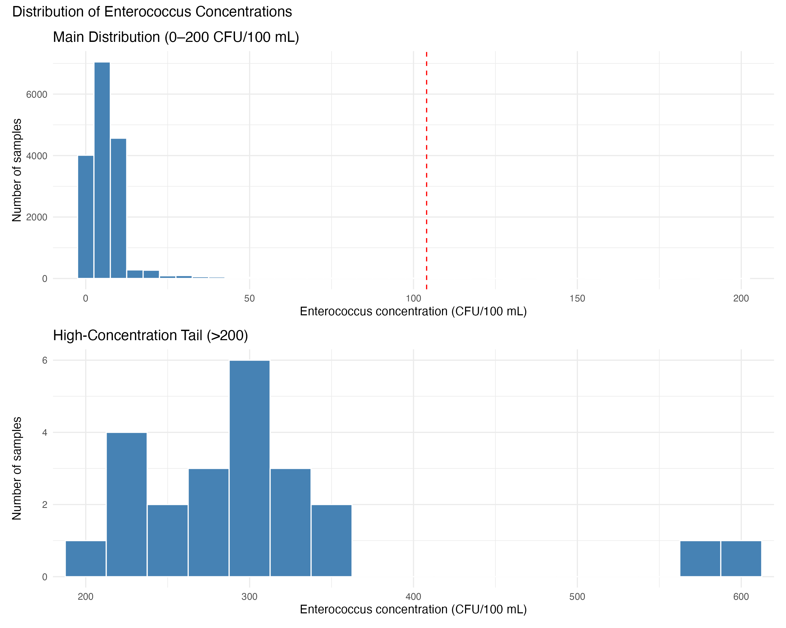

# Assessing Recreational Water Quality at New Jersey Beaches

## Overview

An independent R-based analysis of Enterococcus monitoring measurements collected at recreational beaches in New Jersey. This project explores how measured concentrations and the percentage of samples above a selected threshold vary over time, by month, and across beaches.

---

## Research Questions

- What does the distribution of measured Enterococcus concentrations look like?
- Does the percentage of samples exceeding the selected threshold differ over time or by month?
- Do monitored beaches differ in their observed exceedance rates?
- How are sampling year, season, and beach associated with exceedance status in exploratory logistic-regression models?

---

## Data Source and Threshold

The dataset is attributed to the New Jersey Department of Environmental Protection (NJDEP) and is provided in `Data/nj_beach_water_quality_2021_2025.csv`.

The analysis script classifies a sample as exceeding the selected threshold when `Result_Measure > 104`. The NJDEP's Public Recreational Bathing page describes 104 colony-forming units of Enterococci per 100 mL as the maximum standard concentration for sampled marine waters; see the [official program page](https://www.nj.gov/health/ceohs/phfpp/prb/index.shtml).

---

## Methods and Tools

- Language: R
- Packages: `dplyr`, `ggplot2`, `patchwork`
- Data import, date parsing, and measurement cleaning
- Descriptive statistics and annual/monthly/beach-level summaries
- Data visualization using `ggplot2`
- Binomial logistic regression exploring the association between exceedance status and year, season, or beach

---

## Figures

### Distribution of Enterococcus concentrations

### Enterococcus concentrations over time

### Annual percentage of unsafe samples

### Monthly percentage of unsafe samples

### Beaches with the highest percentage of unsafe samples

---

## Manuscript

[NJ Beach Water Quality Analysis Manuscript](Manuscript/beach_water_quality_manuscript.pdf)

---

## Author

Elle Duffy

Independent biostatistics portfolio project

GitHub Repository: [NJ Beach Water Quality Analysis Repository](https://github.com/elleduffy/nj-beach-water-quality-analysis-2021-2025)
